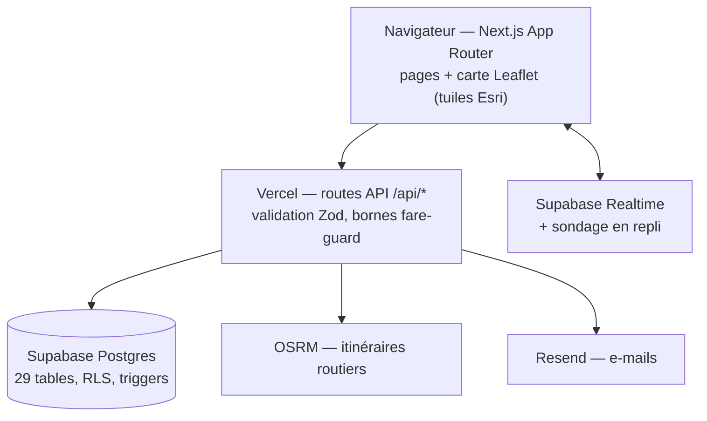
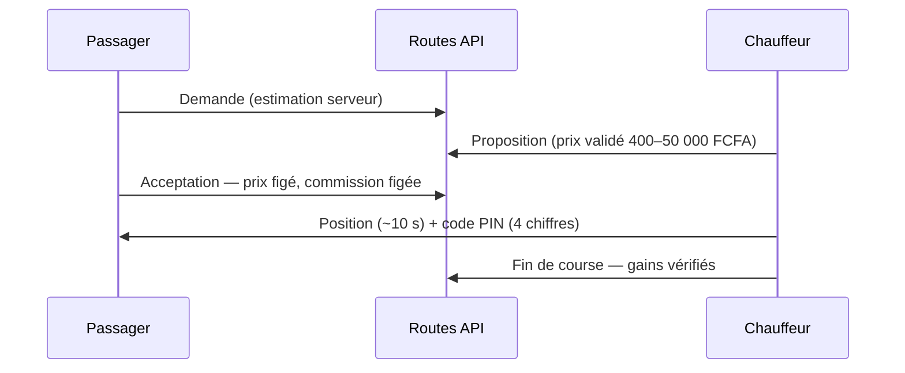

# Stacks Drive


**Stacks Drive** — application de mise en relation chauffeurs / passagers, à Libreville d'abord.

🌐 **En ligne :** https://stacks-drive.vercel.app
🏢 **Par :** Stacks (entreprise individuelle, SIREN 104 314 687)
📍 **Zone :** Libreville, Gabon (d'abord)
📌 **Version en ligne :** v2.6 (commit `65996054`, 14/11/2026)

## C'est quoi ?

Une appli type Uber, pensée pour Libreville : le passager demande une course, les chauffeurs en ligne reçoivent une pop-up et font une proposition (prix, places restantes, premier arrêt). Le passager accepte, refuse, ou contre-propose son prix. Une estimation indicative avant chaque course, des chauffeurs vérifiés, et le chauffeur garde 92 à 95 % de chaque course.

- **Deux types de course :** Solo (privée, directe, prix plein) et Groupe (partagée, prix divisé, arrêts multiples dans l'ordre — par défaut, badge « LE MOINS CHER »). Moto = Solo uniquement.
<!-- DOC-SYNC: readme-commission -->
- **Commission :** 5 % au lancement (3 mois), puis 8 % permanent, **plafond 10 % garanti** (voir `lib/commission.ts`). La commission est calculée sur le total de la course, supplément route non bitumée compris.
- **Paiement :** le passager paie le chauffeur directement (espèces ou transfert P2P Airtel Money / Moov Money). L'appli ne touche jamais l'argent — elle compte seulement. Commission réglée 1 fois par semaine, en un seul transfert Mobile Money. Dépôt de garantie remboursable : 5 000 FCFA. Plafond de dette : ~5 000 FCFA.
<!-- /DOC-SYNC -->
- **Sécurité :** vérification chauffeur automatisée dès l'inscription (selfie + pièce d'identité, décision automatique ou ticket admin), SOS (112), partage de course en direct, code PIN à 4 chiffres donné au chauffeur pour démarrer la course.
<!-- DOC-SYNC: readme-map -->
- **Carte :** 70 quartiers de Libreville avec leurs noms affichés sur la carte (12 visibles au zoom 12, 27 au zoom 13, 69 au zoom 14), 43 lieux (supermarchés, marchés, stations, pharmacies, hôtels, santé, lieux publics), icônes chauffeurs dorées avec note, feuille de demande à 3 positions (façon Uber) avec bouton pour la replier et voir la carte.
<!-- /DOC-SYNC -->
<!-- DOC-SYNC: readme-difficult -->
- **Quartiers à accès difficile :** 15 quartiers ne sont pas desservis sur route bitumée — la course s'arrête par défaut à un point de dépôt sur route bitumée ; le passager peut demander la continuité sur route non bitumée pour un supplément forfaitaire de **800 FCFA**, que le chauffeur est libre d'accepter ou non.
<!-- /DOC-SYNC -->
- **Fidélité :** 10e course offerte ; points chauffeur (100 points/course, 10 000 points = 5 courses sans commission).

## Stack technique

- **Front / back :** Next.js (App Router, React 19) — TypeScript
- **Base de données + Auth :** Supabase (Postgres + RLS) — projet « stacks-drive », région Francfort
- **Hébergement :** Vercel (projet « stacks-drive »)
- **Carte :** Leaflet vanilla + tuiles Esri World Street Map assombries par filtre CSS (gratuites, sans clé) — jamais react-leaflet (conflit peer dep React 19)
- **E-mails admin :** Resend (`RESEND_API_KEY` configurée dans Vercel, Production)

## Documentation technique

Pour un informaticien qui lit le dépôt — stack justifiée choix par
choix, modèle de données, modèle de sécurité, modèle de menaces avec
pointeurs vers le code : **[`docs/ARCHITECTURE.md`](docs/ARCHITECTURE.md)**.
Décisions une par une : [`docs/adr/`](docs/adr/) (Leaflet + Esri,
OSRM, commission par course, RLS + trigger, estimation indicative,
paiement hors appli, Realtime + sondage, vérification automatisée,
périmètre 5 km, prix sur distance haversine). Signaler une faille :
[`SECURITY.md`](SECURITY.md). Contribuer : [`CONTRIBUTING.md`](CONTRIBUTING.md).
Historique des versions : [`CHANGELOG.md`](CHANGELOG.md). Mise en ligne
et maintenance : [`SETUP.md`](SETUP.md).

### Architecture (vue simplifiée)



### Flux d'une course (vue simplifiée)



## Tutoriels visuels réels (v2.21)

- **Passager (premier lancement) :** 6 étapes — carte, trajet + estimation, Solo/Groupe, propositions, prix figé + code PIN, paiement direct. Affiché une seule fois, fermable, rejouable depuis « Mon compte » (« Besoin d’aide ? ») et depuis le pied de la feuille d’accueil (« Revoir le tutoriel »).
- **Chauffeur (formation, après création du compte) :** 6 étapes — mise en ligne, demande entrante, prix + places libres, code PIN, commission (5 % puis 8 %, plafond 10 %), règlement hebdo + règles de conduite. S’ouvre au premier passage sur le tableau de bord, rejouable avec « Revoir la formation ».
- **Captures :** `public/tuto/` — 12 PNG des vrais écrans (Playwright, serveur de dev). Refaire avec `npm run tuto:captures`, vérifier avec `npm run tuto:verify`. Procédure et limites dans `public/tuto/README.md` (dont : fond de carte gris en local, gains « Chargement… » sans Supabase). La page d’aperçu dev `/tuto-apercu` (vrais composants, données démo) répond 404 en production.

## Installation (développement local)

```bash
npm install
cp .env.example .env.local   # renseigner NEXT_PUBLIC_SUPABASE_URL et NEXT_PUBLIC_SUPABASE_ANON_KEY
npm run dev
```

```bash
npm run build   # doit passer avant tout push
```

## Base de données — migrations exécutées

Toutes les migrations ci-dessous sont **exécutées une seule fois** dans Supabase (SQL Editor). **Ne jamais les réexécuter.**

| Fichier | Contenu |
|---|---|
| `supabase/schema.sql` | Schéma v1 |
| `supabase/migration-v2.sql` | Modèle Uber (demandes + propositions, vérification) |
| `supabase/migration-v2.2.sql` | Tableau de bord chauffeur, code PIN, gains, avis & plaintes, journal d'audit |
| `supabase/migration-v2.3.sql` | Points chauffeur, courses sans commission |
| `supabase/migration-v2.4.sql` | Vérification automatisée, tickets admin |
| `supabase/migration-v2.6.sql` | Accès difficile (colonnes `unpaved_requested`, `drop_off_point`, `unpaved_accepted`) |
| `supabase/migration-v2.10.sql` | Messagerie de course + suivi chauffeur (`ride_messages`, `driver_locations`), prix proposé par le passager (`rides.passenger_offered_price`, `ride_proposals.counter_price`) |
| `supabase/migration-v2.15-disputes.sql` | Litiges (`disputes`, `dispute_decisions`, `driver_debt_adjustments`), relevés hebdo (`weekly_settlements`, `settlement_declarations`), rapports hebdo (`weekly_reports`) + fonctions `generate_weekly_settlements`, `insert_weekly_report`, `mark_weekly_report_emailed` — **à exécuter une seule fois, pas encore appliquée** |
| `supabase/migration-v2.17-mode-rules.sql` | Verrouillage du switch Passager → Chauffeur + mise en ligne (règles 1 et 2) : le trigger anti-escalade rejette la bascule en mode Chauffeur sans compte chauffeur créé et la mise en ligne sans compte vérifié — **à exécuter une seule fois, pas encore appliquée** |
| `supabase/migration-v2.19-seats.sql` | Places libres + statut chauffeur (`profiles.free_seats`, trigger de borne `sync_free_seats`) : pop-up des places à la mise en ligne, statut dérivé Vide / En course / Plein, matching Groupe (≥ 1 place libre) / Solo (véhicule totalement vide) — **à exécuter une seule fois, pas encore appliquée** |
| `supabase/migration-v2.20-driver-privacy.sql` | Confidentialité chauffeur : `get_public_ride` (lien de suivi public) ne renvoie plus que les champs d'affichage du chauffeur assigné — jamais téléphone, e-mail, selfie ni pièce d'identité — **à exécuter une seule fois, pas encore appliquée** |
| `supabase/migration-v2.23-p0a.sql` | Plancher P0a : annulation propre (`ride_cancellations` : motif, auteur, historique) + contacts de confiance (`trusted_contacts`, max 5, RLS propriétaire + admin) — **à exécuter une seule fois, pas encore appliquée** |
| `supabase/migration-v2.24-realtime-emails.sql` | Temps réel (`rides`, `ride_proposals`, `ride_messages` dans la publication `supabase_realtime`, RLS inchangée) + drapeaux de déduplication des e-mails automatiques + fonctions `mark_weekly_settlement_emailed`, `mark_settlement_reminder_sent` — **à exécuter une seule fois, pas encore appliquée** |
| `supabase/migration-v2.25-drivers.sql` | Onboarding, parrainage, relances, dépôt (lot C) : code de parrainage (`profiles.referral_code`), table `driver_referrals` + kind `parrainage` dans `driver_points`, `profiles.last_online_at` (trigger à chaque mise en ligne), drapeaux `driver_welcome_seen_at` / `incomplete_reminder_sent_at` / `incomplete_reminder_2_sent_at` / `inactive_reminder_sent_at` + fonctions `ensure_referral_code`, `record_referral`, `credit_referral_bonus`, `mark_driver_reminder_sent` — **à exécuter une seule fois, pas encore appliquée** |
| `supabase/migration-v2.26-fraud.sql` | Sécurité & qualité (lot D) : détection de fraude auto (`profiles.fraud_blocked` + motif + date, table `fraud_cases` — un seul dossier ouvert par utilisateur et par signal) + nettoyage RGPD (table `data_cleanups`) + fonctions `report_fraud_case`, `resolve_fraud_case`, `run_data_cleanup` — **à exécuter une seule fois, pas encore appliquée** |
| `supabase/migration-v2.27-traffic.sql` | Trafic (lot E) : signalements trafic (`traffic_reports` — type, position, expiration 30–60 min par trigger, RLS : seuls les chauffeurs signalent, tout le monde lit) + confirmations (`traffic_confirmations` — 1 par chauffeur et par signalement, mise en évidence dès 2 confirmations) + zones sans chauffeur (`unanswered_zones` — 1 ligne par demande sans proposition depuis plus de 2 min, unicité `ride_id`) — **à exécuter une seule fois, pas encore appliquée** |
| `supabase/migration-v2.30-p1.sql` | Plancher P1 (v2.30) : courses planifiées (`rides.scheduled_at`, `rides.dispatched_at`, statuts `planifiee` / `expiree`) + lieux favoris (`profiles.home_neighborhood`, `home_detail`, `work_neighborhood`, `work_detail`) + re-vérification selfie (`profiles.selfie_recheck_required`, `selfie_recheck_reason`, `last_selfie_check_at` — backfill au jour de la migration pour les chauffeurs déjà vérifiés) — **à exécuter une seule fois, pas encore appliquée** |
| `supabase/migration-v2.34-au-dela.sql` | Lot « Au-delà » (v2.34) : RideCheck (`ridecheck_events`), audio de trajet (`trip_audio`, chiffré, envoyé uniquement en cas de litige, supprimé après 7 jours sans litige), chauffeur favori (`favorite_drivers`, `rides.preferred_driver_id` / `preferred_until`), retour (`profiles.return_destination`, `return_filter_enabled`), classe Confort (`profiles.has_air_conditioning`, `rides.comfort`), file aéroport (`airport_queue`), parrainage doublé (`credit_referral_bonus` remplacée : 2 000 pts parrain / 1 000 pts filleul) — **à exécuter une seule fois, pas encore appliquée**. ⚠️ L'arrondi du prix accepté à 50 FCFA près est implémenté côté serveur mais **à valider par le propriétaire avant le push**. |

## Où sont les docs ?

- **Architecture technique :** [`docs/ARCHITECTURE.md`](docs/ARCHITECTURE.md) (stack justifiée, modèle de données, modèle de sécurité, modèle de menaces) + [`docs/adr/`](docs/adr/) (décisions une par une).
- **Sécurité :** [`SECURITY.md`](SECURITY.md) (signaler une faille, périmètre, modèle de sécurité).
- **Contribuer :** [`CONTRIBUTING.md`](CONTRIBUTING.md).
- **Historique des versions :** [`CHANGELOG.md`](CHANGELOG.md).
- **Mise en ligne et maintenance :** `SETUP.md` (guide unique : installation, déploiement, migrations, dépannage).
- **État des lieux :** [`docs/etat-des-lieux-lancement.md`](docs/etat-des-lieux-lancement.md) (produit, comparaison concurrents, forces et faiblesses — état au 14/11/2026).
- **Vérification automatisée :** [`docs/automatisation-verification.md`](docs/automatisation-verification.md).
- **Pages légales (dans l'appli) :** `app/cgu/page.tsx`, `app/confidentialite/page.tsx`, `app/cookies/page.tsx`, `app/mentions-legales/page.tsx`.
<!-- DOC-SYNC: readme-rules -->- **Règles métier :** `lib/commission.ts` (commission 5 % / 8 % / plafond 10 %), `lib/pricing.ts` (estimation indicative au km : prise en charge + prix au km, AUCUN tarif fixe — le prix final est convenu entre le passager et le chauffeur, supplément route non bitumée 800 FCFA), `lib/neighborhoods.ts` (70 quartiers, accès difficile, points de dépôt), `lib/pois.ts` (43 lieux sur la carte), `lib/fare-guard.ts` (sécurité des prix : bornes absolues 400–50 000 FCFA validées côté serveur, audit).<!-- /DOC-SYNC -->

## État du produit (v2.6, en ligne)

- **v2.1.2** — thème « Libreville la nuit », CGU modèle dépôt + plafond.
- **v2.2** — tableau de bord chauffeur, code PIN, vue course chauffeur, recommandations & plaintes, fiabilité des prix et des paiements, page d'erreur de marque.
- **v2.3** — prix baissés de 24 % (`lib/pricing.ts`, planchers Solo 550 / Groupe 400 FCFA) ; points chauffeur (100 points/course, 10 000 points = 5 courses sans commission, Course Double = points doublés, niveaux = multiplicateurs de points) ; vraie page d'accueil chauffeur.
- **v2.4** — vérification chauffeur automatisée (selfie + OCR de la pièce, décision auto ou ticket admin par e-mail via Resend).
- **v2.5** — icônes chauffeurs dorées (pastille or, anneau cyan, badge note, moto distincte) ; quartiers passés de 20 à 49, avec libellés sur la carte (22 visibles au zoom 12, 48 au zoom 14).
- **v2.5.1** — feuille de demande façon Uber : 3 positions (mini 15 %, aperçu 30 %, pleine 58 %), bouton chevron toujours visible pour replier / déplier, bouton flottant doré en position mini.
- **v2.6** — quartiers à accès difficile (11 quartiers, point de dépôt sur route bitumée, supplément route non bitumée 800 FCFA, chauffeur libre d'accepter ou non) ; 24 lieux affichés sur la carte (pictogrammes dès le zoom 13, noms dès le zoom 15).
- **v2.7** — carte « vivante » : fond Esri World Street Map assombri (rues, eau, parcs, noms de rues), anneaux cyan autour des chauffeurs, lieux colorés par catégorie.
- **v2.8** — carte densifiée : quartiers passés de 49 à 70 (noms réels vérifiés, listes des arrondissements et grille DGI), 3 tiers de libellés (28 visibles au zoom 12, 62 au zoom 13, 70 au zoom 14) ; lieux passés de 24 à 43 ; quartiers difficiles passés de 11 à 16 (même logique : au-delà de PK12 sur la N1 — point de dépôt PK12 —, au-delà d'Angondjé sur la côte nord). Correction : tous les PK jusqu'à PK12 inclus sont bitumés et normaux (PK9, PK11, PK12 retirés des difficiles).
- **v2.9** — tarif au km (option A hybride, décision du propriétaire 14/11/2026) : Solo 450 FCFA prise en charge + 215 FCFA/km, Groupe 250 + 120 FCFA/km, Moto = Solo ×0,6, planchers 550 / 400 FCFA, pas de prix à la minute ; les 6 tarifs fixes de référence sont conservés ; la décomposition du prix s'affiche sous le total (accueil et propositions), le prix reste figé avant la course, jamais de surge. **Remplacé par la v2.11 (ci-dessous) : les tarifs fixes sont supprimés, l'estimation devient indicative.**
- **v2.10** — messagerie de course + suivi chauffeur en direct jusqu'au pickup + historique : messages in-app passager ↔ chauffeur pendant la course (messages rapides « Où êtes-vous ? », « J'arrive », « Je suis devant… » côté passager, aucun numéro affiché) ; le chauffeur partage sa position toutes les ~10 s quand la course est acceptée, le passager le voit se déplacer sur la carte avec « Arrivée dans ~X min » — le partage s'arrête au pickup, la position n'est jamais visible hors course acceptée ; historique des courses dans /compte (passager : date, trajet, type, prix payé, chauffeur, statut, note) et dans le tableau de bord chauffeur (passager, prix, commission / gain net depuis driver_earnings). Migration v2.10 à exécuter (tables ride_messages + driver_locations, RLS stricte ; colonnes `passenger_offered_price` sur rides et `counter_price` sur ride_proposals — prix proposé par le passager et contre-propositions, v2.11).
- **v2.11** — estimation indicative + prix convenu (décision du propriétaire 14/11/2026) : les 6 tarifs fixes de référence sont SUPPRIMÉS — la plateforme ne définit plus aucun prix. L'estimation au km reste affichée avant la course à titre indicatif (Solo 500 + 210 FCFA/km, Groupe 300 + 135 FCFA/km, Moto ×0,6, planchers 550 / 400 FCFA, exemple Centre-ville → Nzeng-Ayong : 1 500 / 950 FCFA) ; le chauffeur propose librement son prix, le passager peut aussi proposer le sien à la demande et contre-proposer sur une proposition — le prix est figé à l'acceptation, jamais de surge ; garde-fou serveur = bornes absolues 400–50 000 FCFA ; pastilles d'accueil = raccourcis d'itinéraire sans prix ; barre de chargement pendant l'attente des propositions ; chip radar « X chauffeurs détectés autour de toi » visible pendant la recherche. Retrait de l'adresse personnelle et de l'e-mail personnel des pages publiques (contact affiché : stacks.markett@gmail.com ; e-mails de tickets admin : `ADMIN_EMAIL`, défaut stacks.markett@gmail.com).
- **v2.12** — notifications pop-up de négociation (toasts in-app, pas de push navigateur, pas de son) : le passager est alerté quand une proposition arrive (« Nouvelle proposition : X FCFA — [prénom] »), quand le chauffeur change son prix et quand le prix est accepté (figé) ; le chauffeur est alerté quand un passager contre-propose (boutons « Accepter » / « Répondre » dans le toast) et quand son prix est accepté — auto-fermeture ~6 s, style « Nuit dorée », jamais de numéro de téléphone affiché. Lien « Mentions légales » ajouté dans la ligne de liens de la feuille d'accueil (la page existait mais n'était joignable que depuis le pied de page des autres pages).
- **v2.15** — litiges in-app + règlements hebdo + rapport hebdo (local, non déployé — migration à exécuter une seule fois) : passager ou chauffeur ouvre un litige depuis sa course (motif, montant, message) ; dossier complet dans /admin (course, prix accepté, messages, position, PIN — jamais de téléphone) ; l'admin tranche en ajustant la dette et/ou la commission (tracé) ; relevé hebdo généré chaque lundi (cron Vercel, `CRON_SECRET`), « J'ai payé » côté chauffeur, validation en 1 clic dans /admin ; rapport hebdo (courses, commission, nouveaux chauffeurs, litiges ouverts, alertes) visible dans /admin et envoyé par e-mail.
- **v2.16** — correctif libellés des quartiers (local, non déployé) : 56 quartiers repositionnés après vérification croisée (Nominatim/OSM, ArcGIS/Esri, Photon, géométrie routière OSRM, Wikipédia) — dont tout l'axe N1 (la N1 file vers l'est à lat ~0,40, pas vers le nord-est : PK5 0,406/9,466, PK12 0,403/9,522, Bikélé 0,400/9,567, Essassa 0,396/9,610, Nkok 0,389/9,623, Nkoltang 0,364/9,674) et les quartiers du sud-est (Acaé, Mindoubé, Lalala, Damas, Oloumi, Sotega…) ; ancre Centre-ville → Nzeng-Ayong FIGÉE (Solo 1 500 / Groupe 950) ; tous les décalages de libellés supprimés (le libellé reste collé à son point) ; densité réduite au lieu de déplacer les libellés (Cité de la Démocratie, La Peyrie et Melen passent au tier 3 ; Likouala sans libellé — collé à l'ancre Centre-ville) : 12 libellés au zoom 12, 27 au zoom 13, 69 au zoom 14, 0 chevauchement mesuré ; points de dépôt Essassa/Nkok/Nkoltang déplacés de PK12 vers Bikélé (quartier bitumé le plus proche avec la vraie géométrie).
- **v2.17** — « Les 2 règles » (local, non déployé — migration à exécuter une seule fois) : **règle 1** — barre de chargement partout où il y a une attente : prix passager (squelette sur les cartes Groupe / Solo, sur le grand prix récapitulatif et pendant l'attente des propositions), mise en ligne chauffeur (accueil chauffeur ET tableau de bord — « Mise à jour… » + spinner, y compris pendant la vérification du nudge de quête), bascule de mode (spinner + « Bascule vers… »), acceptation d'une proposition et envoi / annulation d'une demande ; **règle 2** — verrouillage du switch : impossible de passer en mode Chauffeur sans compte chauffeur créé — sinon redirection vers « Devenir chauffeur » (inscription chauffeur + vérification) ; bascule inverse libre ; mise en ligne exige un compte vérifié ; verrou appliqué côté serveur dans PATCH /api/profile (403 `driver_account_required` / `driver_verification_required`) ET dans la base (migration v2.17 : trigger anti-escalade — ferme aussi le contournement direct via PostgREST) ; basculer en mode Passager met le compte hors ligne, un chauffeur refusé est mis hors ligne.
- **v2.18** — périmètre « chauffeurs autour de toi » (local, non déployé) : la vue passager ne montre QUE les chauffeurs en ligne dans un rayon de **5 km** autour du départ (position exacte si géolocalisé, sinon centre du quartier) — marqueurs masqués hors périmètre, compteur « X chauffeurs autour de toi · dans un rayon de 5 km » qui se recalcule quand le départ change, ETA du chauffeur le plus proche calculée sur le périmètre ; le dispatch est aligné sur le même rayon (premier rayon 5 km, puis élargissement à 25 km après 30 s sans proposition) ; rayon unique et nommé `DRIVERS_AROUND_RADIUS_KM` dans `lib/geo.ts` (élargissement : `DISPATCH_WIDENED_RADIUS_KM`), à changer en un seul endroit. Sans départ choisi, pas de centre : tous les chauffeurs sont affichés.
- **v2.20** — confidentialité chauffeur (local, non déployé — migration à exécuter une seule fois) : l'identité du chauffeur (nom, véhicule, plaque, note) n'apparaît au passager QUE pendant le matching (carte de proposition : prénom + véhicule + plaque + note) et une fois la course acceptée / terminée (carte chauffeur, page de suivi, historique) — jamais avant, sur la carte ou le radar : les marqueurs sont anonymes (« Chauffeur disponible », sans nom, véhicule, plaque ni note — le badge ★ est masqué lui aussi), la liste des chauffeurs en ligne n'est plus sérialisée avec l'identité (position + type de véhicule uniquement) ; le numéro de téléphone du chauffeur ne s'affiche JAMAIS — le bouton d'appel de la carte chauffeur est remplacé par la messagerie in-app, et le téléphone est retiré des réponses passager (`/api/proposals`, `/api/rides/[id]`, suivi public) ainsi que de `get_public_ride`, qui ne renvoie plus la ligne profil complète (ni téléphone, ni e-mail, ni selfie, ni pièce d'identité). La « photo » de la proposition reste l'initiale : le selfie de vérification est un document privé, jamais affiché.
- **v2.19** — places libres + statut chauffeur (local, non déployé — migration à exécuter une seule fois) : à la mise en ligne, une pop-up demande au chauffeur « Combien de places libres dans ton véhicule ? » (borné par la capacité déclarée dans son profil), modifiable à tout moment depuis son accueil ou son tableau de bord (« Mes places ») ; statut dérivé, visible côté chauffeur et admin — **Vide** (aucune course, véhicule libre), **En course** (course en cours, avec ou sans places restantes — une Solo en cours = sans disponibilité), **Plein** (0 place libre) — toujours affiché avec le compteur « X/Y places libres » ; matching des demandes adaptées : Groupe uniquement vers les chauffeurs avec au moins 1 place libre (y compris ceux déjà en course Groupe — taxi partagé), Solo uniquement vers les chauffeurs totalement vides, Plein ne reçoit plus rien ; les places s'occupent à l'acceptation (Groupe − 1, Solo → 0) et se libèrent à la fin ou à l'annulation de la course ; le filtre places / statut s'ajoute au filtre rayon du dispatch (5 km puis 25 km après 30 s), il ne le remplace pas. Avant la migration, les places sont déduites des courses en cours (le statut et le matching restent corrects).
- **v2.22** — listes de quartiers + points de prise en charge (local, non déployé) : listes de départ et de destination triées par ordre alphabétique (70 quartiers, tri français à l'affichage — le fichier de données `lib/neighborhoods.ts` n'est pas réordonné, les tiers de libellés de la carte ne bougent pas) ; recherche par nom dans les deux champs (insensible aux accents, à la casse et aux séparateurs — « aeroport » → Aéroport Léon-Mba, « nzeng ayong » → Nzeng-Ayong — résultats instantanés, clavier flèches / Entrée / Échap, message « Aucun quartier trouvé ») ; les listes de zone côté chauffeur (accueil, tableau de bord) et du profil utilisent le même tri alphabétique ; nouvelle section « Points de prise en charge » sur l'accueil — 10 lieux (aéroport, 2 marchés, 2 stades, 2 gares, université, CHU, hôtel) avec l'estimation indicative Groupe / Solo vers la destination choisie (Centre-ville par défaut), calculée avec le même modèle au km que l'estimation de course et étiquetée « Estimation — indicative » sur chaque ligne — jamais un prix fixe : le prix final se négocie avec le chauffeur ; toucher un lieu le définit comme point de départ. Un vrai prix fixe par zone serait une décision de modèle tarifaire à trancher avec le propriétaire — pas implémenté. Vérification : `npm run quartiers:verify` (Playwright, 20 contrôles).
- **v2.23 (P0a)** — plancher : annulation propre, montant exact à payer + reçu, SOS enrichi, partage auto aux contacts de confiance, PIN visible dès le matching (local, non déployé — migration à exécuter une seule fois) : annulation avec motif obligatoire (liste courte selon le rôle : changement de programme, attente trop longue, chauffeur introuvable… / passager absent, passager injoignable…), notification immédiate à l’autre partie (message système dans la messagerie de course + journal d’audit), historique structuré (`ride_cancellations`) et fiabilité comptée — indicateur visible côté admin (section « Fiabilité — annulations », signalement « À surveiller » : 3+ annulations et taux > 25 %) et sur le profil chauffeur ; libération des places à l’annulation réutilisée de la v2.19 (vérifiée, non dupliquée) ; écran « À payer : X FCFA » à l’arrivée (prix figé, zéro négociation au moment de payer) + récapitulatif écrit avant acceptation (prix, distance, durée sur chaque proposition) + reçu détaillé après chaque course (prix, distance, durée, chauffeur, commission) dans la page de course et l’historique — export PDF / impression fait en v2.30 ; SOS enrichi : au moment de l’appel 112, position GPS + infos course (véhicule, plaque, chauffeur, passager, prix, lien de suivi) préparées pour le dispatcher (copiées dans le presse-papiers), alerte immédiate à l’autre partie, contacts de confiance prévenus en 1 tap (WhatsApp) ; contacts de confiance (max 5, dans « Mon compte ») + envoi automatique du lien de suivi au départ de la course (e-mail via Resend quand une adresse est renseignée ; WhatsApp / SMS en 1 tap depuis l’écran de course — aucun fournisseur SMS branché, donc pas d’envoi SMS direct côté serveur) ; code PIN affiché EN GRAND sur la carte chauffeur dès le matching (accueil confirmé + page de course), pas seulement au pickup. Résilient sans la migration : annulation et fiabilité fonctionnent depuis `rides` (`cancelled_by` / `cancel_reason`), contacts et historique détaillé exigent la migration v2.23.
- **v2.24 (lot B — temps réel & support)** — temps réel Supabase Realtime pour les propositions, les demandes et les messages (sondage en repli si indisponible, RLS inchangée) ; FAQ in-app `/aide` (prix, PIN, paiement, annulation, Solo vs Groupe, estimation) — les cas ambigus renvoient vers un litige ou l'administrateur ; alertes d'exception uniquement (5 faux PIN, plafond de dette, cron en échec, erreur API répétée — helper unique `lib/admin-alerts.ts`, un seul e-mail par événement, sans doubler les e-mails litige du lot A ni les tickets v2.4) ; e-mails automatiques via Resend (bienvenue passager / chauffeur, récap hebdo des gains par chauffeur, rappels de règlement — dédupliqués en base, envoyés le lundi dans le cron du rapport hebdo). (local, non déployé — migration à exécuter une seule fois)
- **v2.25 (lot C — chauffeurs : onboarding, parrainage, relances, dépôt)** — onboarding 100 % autonome : bienvenue in-app sur le tableau de bord chauffeur (en complément de l'e-mail du lot B, fermable une fois) + rappel si le dossier de vérification est incomplet après 48 h (message in-app + e-mail, une seule fois), puis une relance à J+7 si toujours incomplet (les dossiers « en attente » attendent l'administrateur, pas le chauffeur : jamais relancés) ; parrainage chauffeurs SILENCIEUX (jamais annoncé sur les pages publiques — visible uniquement côté chauffeur et côté admin) : chaque chauffeur vérifié a un code unique (`SD-NOM-XXXX`, créé à la vérification, champ facultatif à l'inscription chauffeur), bonus en points du système existant quand le filleul est vérifié ET a terminé 5 courses — 1 000 points au parrain, 500 au filleul (10 000 points = 5 courses sans commission), crédités par le cron hebdo ; relances des chauffeurs inactifs (vérifiés, jamais en ligne ou absents depuis 7 jours — message in-app + e-mail, max 1/semaine/chauffeur, jamais un chauffeur bloqué par la dette ni un chauffeur refusé) ; rappel du dépôt / dette au plafond côté chauffeur — message « Régularise pour reprendre » avec le montant dû et le moyen de règlement, visible sur son tableau de bord et son accueil (il ne duplique ni l'alerte admin ni le rappel e-mail du lot B). Aucun nouveau cron Vercel : relances et récompenses passent par `/api/cron/weekly-report`. (local, non déployé — migration à exécuter une seule fois)
- **v2.26 (lot D — sécurité & qualité)** — détection de fraude automatique : 4 signaux agrégés — annulations en série (6+ et taux > 40 %, au-delà du signalement P0a 3+ / 25 %), vitesse moyenne impossible (> 150 km/h sur une course terminée), faux PIN répétés (2 courses verrouillées sur 30 jours, au-delà du verrouillage lot B), téléphone partagé entre comptes (alerte dès 2, blocage dès 3) — une seule alerte admin par cas (sorte `fraud_detected`, dossier `fraud_cases`, anti-rafale en base) + blocage temporaire automatique (mise hors ligne + marqueur « à vérifier », réversible dans /admin, tracé dans l'audit ; le paiement et la dette ne sont jamais touchés) ; nettoyage automatique des données — RGPD : positions chauffeur supprimées après 24 h, propositions expirées passées à `expired` (historique conservé), comptes inactifs (≥ 12 mois) comptés seulement — jamais supprimés ni anonymisés automatiquement — le tout par le cron hebdo existant `/api/cron/weekly-report` (aucun nouveau cron Vercel), journalisé dans `data_cleanups` et visible dans /admin ; tests automatiques à chaque push : workflow GitHub Actions `.github/workflows/ci.yml` (`npm run build` + `npm run docs:check`, aucun secret) ; vérification locale : `node scripts/verify-lot-d.mjs`. (local, non déployé — migration à exécuter une seule fois)
- **v2.27 (lot E — trafic)** — itinéraire routier : la carte trace le vrai trajet par les rues (OSRM, serveur démo public sans clé — Centre-ville → Nzeng-Ayong : 6,5 km, ~10 min) au lieu de la ligne droite, et la feuille + le détail de course affichent la durée et la distance routières — le PRIX ne change pas (modèle au km sur la distance à vol d'oiseau, Solo 500 + 210/km, Groupe 300 + 135/km) ; repli ligne droite si OSRM est indisponible ; cache serveur 5 min par trajet, URL en variable d'environnement (`OSRM_BASE_URL`) — démo uniquement, l'auto-hébergement OSRM sur VPS viendra au lancement ; trafic communautaire : pendant une course, le chauffeur signale Embouteillage / Accident / Travaux / Route fermée à sa position — marqueurs sur la carte des passagers ET des chauffeurs (suivi de course), expiration auto 30–60 min, modération auto (mise en évidence dès 2 confirmations par d'autres chauffeurs, jamais de confirmation de son propre signalement, anti-doublon 500 m / 10 min) ; zones sans chauffeur : une demande sans proposition depuis plus de 2 min alerte les chauffeurs proches (une seule alerte par demande, bannière sur l'accueil chauffeur) et est journalisée dans /admin pour cibler le recrutement — aucun nouveau cron (vérification à chaque sondage des demandes entrantes). (local, non déployé — migration à exécuter une seule fois)
- **v2.28 (P0b — ETA chauffeur + navigation guidée)** — ETA routière : dès la proposition reçue (si la position du chauffeur est connue) et pendant toute la course acceptée, le passager voit « Arrivée dans ~X min · Y km par la route » (distance et durée OSRM chauffeur → pickup, recalculées quand le chauffeur bouge d'environ 100 m ou toutes les 30 s — réutilise le sondage 5 s existant, aucun nouveau polling agressif) ; le chauffeur voit la même ETA vers le pickup, puis vers la destination une fois la course démarrée ; sans OSRM, repli sur l'estimation à vol d'oiseau (30 km/h) — jamais d'écran vide ; navigation guidée chauffeur : itinéraire routier vers le pickup puis vers la destination tracé sur la carte, instructions virage par virage en français (manœuvres OSRM, étape courante mise en avant) + bouton « Ouvrir dans l'app Cartes » (lien Google Maps gratuit, sans compte) — pas de navigation vocale native, pas de service payant ; le PRIX ne change pas, `lib/pricing.ts` et `lib/commission.ts` intouchés. Aucune migration (calculs en lecture uniquement), aucun nouveau cron. Vérification locale : `node scripts/verify-p0b.mjs`. (local, non déployé)
- **v2.29 (lot F — réponses automatiques aux plaintes standard)** — une plainte depuis une course terminée ou annulée ne remonte plus d'emblée à un humain : sujet choisi d'abord (retard, attente, annulation, prix, paiement, itinéraire, véhicule, autre problème) ; si le sujet est standard, réponse auto IMMÉDIATE et concrète (prix figé accepté, estimation indicative, annulation = aucune facturation, actions existantes, lien FAQ `/aide#retard` / `#prix` / `#paiement` / `#annulation`), journalisée dans `audit_log` (`complaint_auto_replied`), sans litige ni e-mail ; escalade en litige (flux v2.15 : dossier /admin + e-mail admin, badge « Après réponse auto ») en cas de mot grave (fraude, vol, danger…), de montant contesté > 5 000 FCFA, de sujet « Autre », ou de rejet de la réponse auto (« Ça ne résout pas mon problème ») — classification re-faite côté serveur, aucune compensation automatique (ni remise, ni remboursement, ni crédit : l'application ne touche jamais l'argent). Nouvelle entrée FAQ « Mon chauffeur est en retard, que faire ? ». Aucune migration (réutilisation de `disputes` / `audit_log`), aucun nouveau cron, `lib/commission.ts` intouché. Vérification locale : `node scripts/verify-lot-f.mjs`. (local, non déployé)
- **v2.31 (carte zonée quartier)** — la carte s'ouvre sur le quartier de la personne, jamais sur toute la ville : zoom d'ouverture 14 (`MAP_INITIAL_ZOOM`, `lib/geo.ts`), centré sur l'ancre — position GPS réelle si elle est dans la zone de service, sinon quartier de départ choisi (y compris le brouillon restauré après connexion), sinon Centre-ville ; le départ se cale par défaut sur le quartier le plus proche de la position GPS. Géolocalisation silencieuse au chargement (5 s, repli immédiat sans bloquer l'ouverture, position jamais envoyée au serveur). Cercle périmètre statique de 5 km autour de l'ancre (trait or pointillé, même rayon que le matching `DRIVERS_AROUND_RADIUS_KM` — distinct du radar cyan pulsé de la recherche) : il suit la position GPS par défaut, et le quartier de départ dès qu'il est choisi manuellement. « Me localiser » centre au zoom quartier si la position est dans la zone de service (`SERVICE_BOUNDS`, Grand Libreville, `lib/geo.ts` — test d'appartenance, plus de seuil de distance) ; hors zone, la carte reste sur Libreville avec le message « le service est à Libreville pour l'instant ». Bornes fermes sur la zone de service (`maxBounds` + `maxBoundsViscosity: 1.0`) et zoom minimum 12 : on dézoome jusqu'à la vue ville (12 libellés), jamais jusqu'à tout le pays. Tiers de libellés et listes de départ / destination (quartiers de Libreville uniquement) inchangés. Aucune migration, aucun nouveau cron, `lib/commission.ts` intouché. Vérification locale : `node scripts/verify-lot-v231.mjs`. (local, non déployé)
- **v2.30 (plancher P1)** — notes dans les deux sens (le chauffeur note aussi le passager, 1–5 étoiles + commentaire, via le formulaire existant ; la note moyenne du passager est visible par le chauffeur dans la demande entrante, la liste des demandes et la carte de course — « Nouveau passager » si aucune course notée, jamais 0 inventé ; la note du chauffeur côté passager existait déjà) ; courses planifiées (date/heure future, 30 min à 7 jours, statut « planifiée », annulable avant envoi ; envoi automatique aux chauffeurs proches ~15 min avant l'heure prévue, déclenché par le sondage existant des demandes entrantes — aucun nouveau cron, route `/api/cron/scheduled-dispatch` en filet de sécurité seulement, non programmée ; heure passée sans chauffeur = « expirée », relançable en 1 tap) ; lieux favoris (Maison / Travail : quartier + précision libre dans « Mon compte », modifiables/supprimables, raccourcis 1 tap sur l'accueil pour le départ ou la destination) ; heatmap de demande côté chauffeur (zones les plus demandées sur 7 jours, vraies demandes uniquement, info seulement — sans surge, sans prix dynamique, sans promesse de gain) ; messages rapides côté chauffeur (« J'arrive », « Je suis devant… », « Je vous attends », « Je suis en route », messagerie in-app uniquement) ; re-vérification selfie ponctuelle (drapeau posé par l'admin après un signalement/litige, ou par le balayage hebdo quand le dernier contrôle date de plus de 30 jours — au plus 5 chauffeurs par semaine, donc pas plus d'1 fois par mois ; contrôle de présence d'un visage uniquement, jamais de reconnaissance faciale, photo non conservée ; en cas de doute, ticket admin v2.4, pas de blocage définitif automatique ; la mise en ligne est bloquée tant que le selfie n'est pas refait) ; gains détaillés par course (date, trajet, prix accepté, commission, gain net, depuis `driver_earnings`, export CSV côté client) ; export PDF / impression du reçu (bouton « Imprimer / Exporter le reçu » sur la page de course et dans l'historique — `window.print` + CSS print, « Enregistrer au format PDF » dans la boîte d'impression, aucune dépendance) ; formation chauffeur déjà faite par les tutos v2.21 — vérifié : rejouable depuis le tableau de bord (« Revoir la formation »). Migration v2.30 à exécuter une seule fois (statuts `planifiee` / `expiree`, lieux favoris, re-vérification selfie) ; sans elle, les planifiées renvoient une erreur explicite et le reste fonctionne. Aucun nouveau cron Vercel, `lib/commission.ts` intouché. Vérification locale : `node scripts/verify-lot-p1.mjs`. (local, non déployé)

## Règles à respecter avant de modifier le code

1. Ne jamais toucher aux taux de `lib/commission.ts` sans décision du propriétaire.
2. L'estimation est calculée **côté serveur uniquement** (`lib/pricing.ts`) ; le prix final est convenu entre le passager et le chauffeur et validé côté serveur (`lib/fare-guard.ts`, bornes 400–50 000 FCFA) — jamais de prix accepté tel quel sans validation.
3. Les chauffeurs ne publient rien : ils se mettent en ligne, le passager demande, le chauffeur propose. Modèle Uber, pas BlaBlaCar.
4. L'appli ne touche jamais l'argent : pas de wallet prépayé, pas d'abonnement.
5. `npm run build` doit passer avant tout push. Vérifier en vrai navigateur, en chargement frais, après chaque déploiement.
6. **Les 2 règles (priorité n°1, à vérifier après chaque lot) :** (a) barre de chargement partout où il y a un temps d'attente — prix passager, mise en ligne chauffeur (accueil + tableau de bord), bascule de mode ; (b) impossible de passer en mode Chauffeur sans compte chauffeur créé — sinon redirection vers « Devenir chauffeur » ; la mise en ligne exige un compte vérifié ; le verrou est côté serveur (PATCH /api/profile) ET dans la base (trigger anti-escalade, migration v2.17) — jamais dans l'interface seule.
