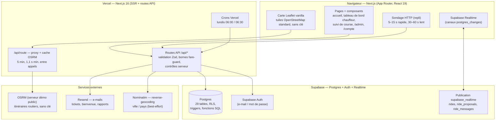
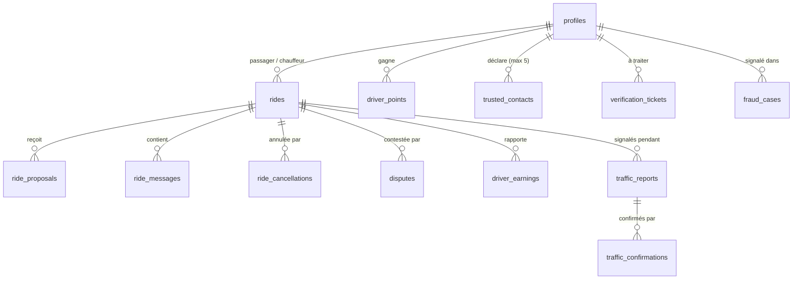
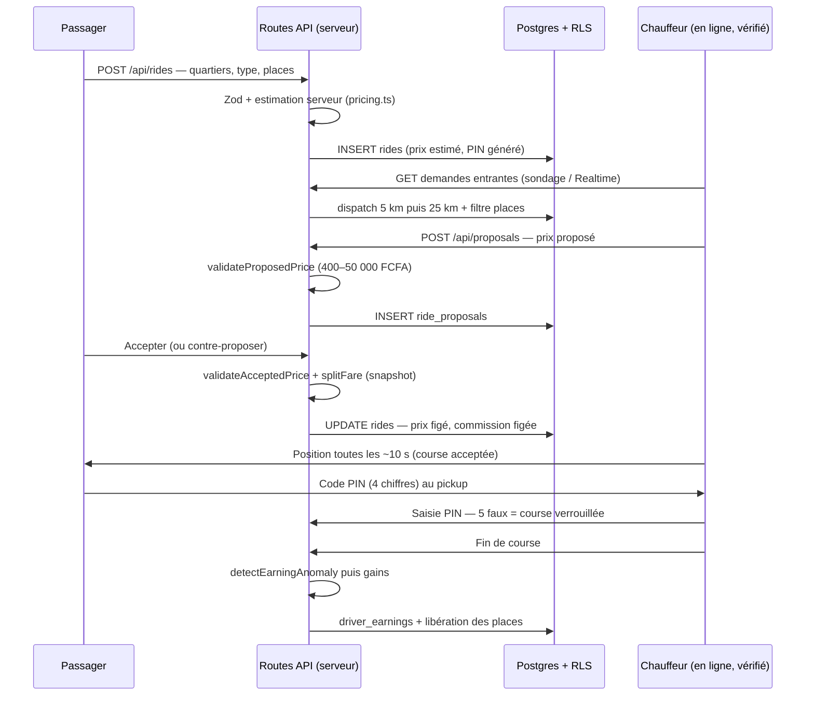

# Stacks Drive — Architecture technique

> Document de référence pour tout informaticien qui lit le dépôt : ce que
> fait le système, comment il est construit, pourquoi chaque choix a été
> fait, et où sont les filets de sécurité. Chaque affirmation renvoie à du
> code ou à une migration du dépôt — rien n'est décrit ici qui n'existe
> pas dans le code.
>
> Public : développeurs, partenaires techniques, investisseurs techniques.
> Pour la mise en ligne et la maintenance opérationnelle, voir `SETUP.md`.
> Pour l'historique des versions, voir `CHANGELOG.md`. Pour les décisions
> une par une, voir `docs/adr/`.

- **Produit :** application de mise en relation chauffeurs / passagers à
  Libreville (Gabon), modèle Uber — le passager demande, le chauffeur
  propose, le prix se convient puis se fige.
- **Zone :** Grand Libreville uniquement — 70 quartiers, bornes
  géographiques fermes (`SERVICE_BOUNDS`, `lib/geo.ts`).
- **Hébergement :** Vercel (projet « stacks-drive ») ; base + auth :
  Supabase (projet « stacks-drive », région Francfort).
- **Version du document :** v2.33 — état du code au 14/11/2026.

---

## 1. Vue d'ensemble

### 1.1 Schéma d'architecture



### 1.2 Principes directeurs

Ces principes sont appliqués partout dans le code ; ils expliquent la
plupart des décisions ci-dessous.

1. **Le serveur décide, le client affiche.** Aucune donnée envoyée par le
   navigateur n'est crue sans validation côté serveur : prix validés par
   `lib/fare-guard.ts`, estimation calculée côté serveur uniquement,
   bascule de rôle verrouillée côté serveur ET en base.
2. **La base est le dernier rempart.** Les politiques RLS et les triggers
   Postgres appliquent les règles même si quelqu'un contourne
   l'application et appelle Supabase directement (PostgREST, clé anon).
   L'API donne des messages clairs ; la base donne des rejets.
3. **L'application ne touche jamais l'argent.** Pas de portefeuille
   prépayé, pas d'abonnement, pas de paiement in-app : le passager paie
   le chauffeur directement (espèces ou transfert P2P Airtel Money /
   Moov Money). L'application compte seulement, puis le chauffeur règle
   sa commission une fois par semaine. Conséquence : il n'y a pas de
   flux de paiement à sécuriser, et aucun secret de paiement dans le
   dépôt.
4. **Dégradation gracieuse, jamais d'écran vide.** Chaque dépendance
   externe a un repli : OSRM indisponible → ligne droite ; Realtime
   indisponible → sondage ; migration non appliquée → erreur explicite
   ou repli calculé depuis les données existantes ; Supabase non
   configuré → build OK, pages vides.
5. **Un seul endroit pour chaque règle.** Chaque constante de règle
   métier n'existe qu'à un endroit (`DRIVERS_AROUND_RADIUS_KM`,
   `COMMISSION_RATE`, bornes fare-guard…) et tous les appelants la
   partagent — la carte, le dispatch et le compteur ne peuvent pas se
   désaligner.
6. **Aucun secret dans le dépôt.** Seule la clé anon Supabase (publique,
   protégée par RLS) est exposée côté client. Aucune clé `service_role`
   dans le code. Les secrets vivent dans les variables d'environnement
   Vercel (`RESEND_API_KEY`, `CRON_SECRET`, `ADMIN_EMAIL`…).

---

## 2. Stack — et pourquoi chaque choix

| Couche | Technologie (version) | Pourquoi ce choix | Alternative écartée |
|---|---|---|---|
| Framework | Next.js 16.2.6, App Router, React 19.2.6, TypeScript 5 | Un seul dépôt pour le front et le back (routes API) : pas de serveur séparé à opérer, déploiement Vercel en un push, SSR pour les pages publiques. TypeScript strict sur tout le métier. | Serveur Express séparé — une pièce de plus à héberger et à sécuriser, sans gain pour ce volume. |
| Base + Auth | Supabase : Postgres, Auth, Realtime (`@supabase/supabase-js` 2.119.0, `@supabase/ssr` 0.12.7), projet « stacks-drive », région Francfort | Postgres géré + Auth e-mail/mot de passe + RLS au niveau ligne + Realtime sur les mêmes tables : une seule infrastructure pour les données, l'identité et le temps réel. Région Francfort = latence la plus faible pour le Gabon parmi les régions Supabase disponibles, et cadre UE. | Firebase — RLS Postgres et les triggers SQL sont le cœur du modèle de sécurité (voir §5) ; les règles Firestore n'offrent pas l'équivalent des triggers anti-escalade. |
| Carte | Leaflet 1.9.4 **vanilla** + tuiles OpenStreetMap standard (une seule carte, fond clair, sans clé — v2.53, ADR 0029) | Leaflet est la bibliothèque de cartes la plus légère et la plus éprouvée ; **vanilla, pas react-leaflet** — react-leaflet est incompatible avec React 19 (conflit de peer dependency). Tuiles OSM standard : fond clair, avec rues, eau, parcs et noms de rues à Libreville (voir ADR 0029 — lisibilité des libellés à confirmer en live après push, et réserve sur les vérifications curl depuis la VM). Une seule carte depuis la v2.50 (ADR 0026 : la bascule Plan/Satellite est retirée). | MapLibre — voir ADR 0001. Google Maps — clé payante + facturation au volume, disproportionnée pour Libreville. |
| Routage | OSRM (Open Source Routing Machine), serveur démo public `router.project-osrm.org`, sans clé, surchargeable par `OSRM_BASE_URL` | Itinéraires routiers réels (rues, virages) sans compte ni clé ; le prix en dépend depuis la v2.50 (distance routière, ADR 0025), avec un repli explicite (vol d'oiseau + mention « estimation approximative ») quand OSRM est indisponible — une panne OSRM ne bloque donc jamais une course. | Google Maps Directions — voir ADR 0002. |
| E-mails | Resend 6.38.1 | API simple, plan gratuit suffisant pour les volumes actuels (tickets admin, bienvenue, rapports hebdo) ; envoi via un seul point d'appel (`lib/email.ts`), jamais d'exception levée. | SendGrid / SMTP maison — plus lourd à opérer pour le même besoin. |
| Hébergement | Vercel (projet « stacks-drive ») | Déploiement par push, crons natifs (2 crons hebdo), HTTPS et prévisualisations sans configuration. | VPS — à réserver à l'auto-hébergement OSRM (voir ADR 0002), pas à l'application. |
| CI | GitHub Actions (`.github/workflows/ci.yml`, Node 20) | À chaque push / PR sur `main` : `npm run build` + `npm run docs:check`. Aucun secret : le build passe sans Supabase configuré. | Aucune — la CI est le minimum pour un dépôt partagé. |
| Validation | Zod 3.23.8 | Schémas déclaratifs sur chaque route API (ex. `app/api/rides/route.ts` : quartiers dans l'enum des 70, type Solo/Groupe, places 1–4) : un corps invalide est rejeté avant toute lecture en base. | Validation manuelle — source d'oublis, non testable de la même façon. |
| OCR / visage | Tesseract.js 7.0.0 (client) | OCR de la pièce d'identité sans serveur dédié ni service payant ; détection de **présence** d'un visage uniquement — jamais de reconnaissance faciale. | Service d'identité tiers (Onfido, etc.) — coût par vérification, hors budget au lancement. |
| Styles | Tailwind CSS 3.4.1 | Classes utilitaires, thème « Libreville la nuit » centralisé. | — |

---

## 3. Modèle de données

### 3.1 Tables (29)

Schéma de base : `supabase/schema.sql` (v1), puis 17 migrations
`supabase/migration-v2.sql` → `supabase/migration-v2.32-out-of-zone.sql`.
Chaque migration s'exécute **une seule fois** dans Supabase (SQL Editor)
et est idempotente (`CREATE OR REPLACE`, `DROP TRIGGER IF EXISTS`,
`IF NOT EXISTS`). Le README liste chaque migration et son contenu.

| Domaine | Tables |
|---|---|
| Identité | `profiles` (rôle, vérification, véhicule, places libres, dépôt, dette, parrainage, lieux favoris) |
| Courses | `rides` (demande + course : quartiers, type, prix estimé / proposé / figé, commission figée, PIN, statuts, planifiée), `ride_proposals` (propositions + contre-propositions), `bookings` (modèle v1, historique) |
| Temps réel / suivi | `ride_messages` (messagerie in-app), `driver_locations` (positions chauffeur, supprimées après 24 h) |
| Argent | `driver_earnings`, `driver_settlements`, `weekly_settlements`, `settlement_declarations`, `weekly_reports` |
| Confiance | `ride_feedback` (notes dans les deux sens), `verification_tickets`, `ride_cancellations`, `trusted_contacts` (max 5), `disputes`, `dispute_decisions`, `driver_debt_adjustments` |
| Chauffeurs | `driver_points`, `driver_badges`, `quest_bonus_claims`, `driver_referrals`, `driver_locations` |
| Sécurité / qualité | `fraud_cases` (un seul dossier ouvert par utilisateur et par signal), `data_cleanups`, `audit_log` |
| Trafic / zone | `traffic_reports`, `traffic_confirmations`, `unanswered_zones`, `area_waitlist` |

### 3.2 Relations principales



### 3.3 Invariants de données (ce que le code garantit)

- **Prix figé = snapshot.** À l'acceptation, `rides` fige le prix
  accepté, la part plateforme et la part chauffeur (`splitFare`,
  `lib/commission.ts`). Un changement de taux plus tard ne modifie
  jamais les courses déjà réservées.
- **Statut chauffeur dérivé, jamais stocké.** Vide / En course / Plein
  se recalcule à chaque lecture depuis les places libres et les courses
  en cours (`deriveDriverStatus`, `lib/seats.ts`) : il ne peut pas se
  désynchroniser.
- **Places libres bornées.** `free_seats` est borné par la capacité
  déclarée (`normalizeFreeSeats`) et par un trigger de borne en base
  (`sync_free_seats`, migration v2.19). NULL = jamais déclarées =
  capacité entière libre.
- **Unicité anti-doublon.** Un seul dossier de fraude ouvert par
  utilisateur et par signal ; une seule confirmation par chauffeur et
  par signalement trafic ; une seule ligne `unanswered_zones` par
  demande ; un seul e-mail par événement d'alerte admin
  (`lib/admin-alerts.ts`) ; e-mail unique (insensible à la casse) dans
  `area_waitlist` — une deuxième inscription renvoie un succès
  idempotent.
- **Résilience aux migrations non appliquées.** Le code détecte
  l'absence d'une colonne / fonction (erreur `42703`, fonction
  absente) et replie : places déduites des courses en cours avant
  v2.19, annulation et fiabilité depuis `rides` avant v2.23, courses
  planifiées en erreur explicite avant v2.30. Jamais de crash silencieux.

---

## 4. Moteurs cœur

### 4.1 Estimation au km — `lib/pricing.ts`

L'estimation est **indicative** : la plateforme ne définit aucun prix
fixe (les tarifs de référence ont été supprimés en v2.11). Le prix final
se convient entre le passager et le chauffeur (proposition /
contre-proposition) et se fige à l'acceptation — jamais de surge.

Formule (constantes dans `lib/pricing.ts`, source unique) :

```
estimation = max(plancher, arrondi50(prise en charge + taux/km × distance))
```

| | Solo | Groupe |
|---|---|---|
| Prise en charge | 500 FCFA | 300 FCFA |
| Taux / km | 210 FCFA | 135 FCFA |
| Plancher | 550 FCFA | 400 FCFA |
| Supplément aéroport (Léon-Mba) | +800 FCFA | +300 FCFA |

- **Distance = distance ROUTIÈRE (OSRM) entre les points exacts du
  trajet** (v2.50, ADR 0025 — remplace l'ADR 0010) : le prix dépend
  d'OSRM, avec un repli explicite (vol d'oiseau + mention
  « estimation approximative ») quand OSRM est indisponible — jamais
  de prix inventé. L'ancre Centre-ville ↔ Nzeng-Ayong (Solo 1 500 /
  Groupe 950 FCFA) est une valeur fixe, pas un calcul.
- **Moto = Solo × 0,6**, plancher 550 FCFA appliqué après la remise ;
  la moto n'existe qu'en Solo (1 place).
- **Route non bitumée : +800 FCFA forfaitaire**, ajouté après tout le
  reste (remise moto comprise) — jamais remisé ; la commission
  s'applique sur le total, supplément compris.
- **Arrondi aux 50 FCFA** (`round50`) : les prix affichés sont des
  montants ronds, payables en espèces.
- **Durée affichée** = distance / 25 km/h + 2 min (minimum 5 min) —
  affichée, jamais facturée. **ETA chauffeur** = 2 min + distance /
  28 km/h (minimum 2 min).
- **Ancre de recalage :** Centre-ville → Nzeng-Ayong = Solo 1 500 /
  Groupe 950 FCFA. Toute modification des constantes doit préserver
  cette ancre.
- **Calculée côté serveur uniquement** à la création de la demande —
  jamais depuis le client.

### 4.2 Commission — `lib/commission.ts`

Décision validée : **5 % au lancement (3 mois), puis 8 % permanent,
plafond garanti 10 %** (`COMMISSION_RATE`, `COMMISSION_RATE_PERMANENT`,
`COMMISSION_CAP`, `COMMISSION_LAUNCH_MONTHS`). `splitFare(total)` découpe
le prix figé : part plateforme arrondie, part chauffeur = total − part
plateforme (la somme est donc exacte par construction — c'est ce que
vérifie `validateSplit`, `lib/fare-guard.ts`).

Modèle économique (voir ADR 0003) : commission par course, pas
d'abonnement, pas de portefeuille prépayé. Dépôt de garantie remboursable
**5 000 FCFA** et plafond de dette **~5 000 FCFA** (`DEPOSIT_FCFA`,
`DEBT_CAP_FCFA`, `lib/gamification.ts`) : au-delà du plafond, le
chauffeur ne reçoit plus de demandes tant qu'il n'a pas régularisé.
Règlement hebdomadaire en un seul transfert Mobile Money, généré chaque
lundi par le cron (`/api/cron/weekly-settlements`, 06:00).

### 4.3 Dispatch / matching — `lib/rides.ts` (`getIncomingRequests`)

1. Une demande est visible par les chauffeurs pendant **15 minutes**
   (`since = now − 15 min`) ; une course planifiée est envoyée ~15 min
   avant l'heure prévue et expire 30 min après l'heure passée sans
   chauffeur (v2.30).
2. **Premier rayon : 5 km** autour du départ (`DRIVERS_AROUND_RADIUS_KM`,
   `lib/geo.ts`) — le même rayon que la vue passager « chauffeurs
   autour de toi » et que le cercle dessiné sur la carte, pour que
   l'affichage et le matching ne se désalignent jamais.
3. **Après 30 s sans proposition, élargissement à 25 km**
   (`DISPATCH_WIDENED_RADIUS_KM`).
4. **Filtre places** (`canReceiveRide`, `lib/seats.ts`, une seule
   fonction partagée par le dispatch et le garde-fou de proposition) :
   Groupe → chauffeurs avec ≥ 1 place libre (y compris déjà en course
   Groupe — taxi partagé) ; Solo → chauffeurs totalement vides
   uniquement ; Plein → aucune demande ; une Solo en cours bloque tout.
5. **Filtre vérification** : seuls les chauffeurs vérifiés et en ligne
   apparaissent — le radar ne montre de toute façon que ceux-là.
6. **Zones sans chauffeur** : une demande sans proposition depuis plus
   de 2 min alerte les chauffeurs proches (une seule alerte par demande)
   et est journalisée dans /admin (`unanswered_zones`, v2.27).

### 4.4 Places libres — `lib/seats.ts`

Transitions **côté serveur uniquement** : acceptation Groupe − 1 place,
acceptation Solo → 0, fin / annulation → libération (Groupe + 1 plafonné
à la capacité, Solo → capacité entière). La pop-up « Combien de places
libres ? » à la mise en ligne est bornée par la capacité déclarée.
Voir §3.3 pour les invariants.

### 4.5 Code PIN — 4 chiffres

Le PIN est généré à la création de la course et affiché au passager ;
le chauffeur doit le saisir pour démarrer la course. Il est visible en
grand sur la carte chauffeur dès le matching (v2.23), pas seulement au
pickup. **5 codes faux = course verrouillée** (`pin_locked`) + alerte
admin + entrée `audit_log` (`pin_locked`) ; déverrouillage par l'admin
uniquement (`pin_unlocked`). Le PIN n'est jamais envoyé par SMS ni
affiché hors des parties de la course.

### 4.6 Vérification chauffeur — `lib/verification.ts`

Parcours 100 % in-app : selfie + pièce d'identité à l'inscription
chauffeur. Contrôles côté client : présence d'un visage sur le selfie,
OCR de la pièce (Tesseract.js), cohérence du nom entre le compte et la
pièce. **Décision automatique ou ticket admin** : si les signaux sont
bons, vérification automatique ; sinon, ticket admin avec e-mail via
Resend (`verification_tickets`).

Limite honnête, documentée dans le code : les signaux OCR / visage sont
rapportés par le client ; le serveur **re-parse le texte OCR et
re-calcule la cohérence** (`verification_auto_payload_consistent`) et
vérifie les doublons en base, mais il ne refait pas l'OCR lui-même. Une
re-vérification OCR 100 % serveur n'existe pas encore — c'est un
renforcement possible, pas une affirmation du système actuel.

Re-vérification selfie ponctuelle (v2.30) : drapeau posé par l'admin ou
par le balayage hebdo quand le dernier contrôle date de plus de 30 jours
— au plus 5 chauffeurs par semaine ; contrôle de présence d'un visage
uniquement, photo non conservée ; en cas de doute, ticket admin, pas de
blocage définitif automatique ; la mise en ligne est bloquée tant que le
selfie n'est pas refait.

### 4.7 Litiges — `lib/disputes.ts`

Passager ou chauffeur ouvre un litige depuis sa course (motif, montant,
message). Dossier complet dans /admin : course, prix accepté, messages,
position, PIN — **jamais de téléphone**. L'admin tranche en ajustant la
dette et/ou la commission, chaque décision tracée
(`dispute_decisions`, `driver_debt_adjustments`). Plaintes standard :
réponse automatique immédiate et concrète d'abord (v2.29), escalade en
litige sur mot grave, montant contesté > 5 000 FCFA, sujet « Autre » ou
rejet de la réponse auto — classification refaite côté serveur, **aucune
compensation automatique** (ni remise, ni remboursement, ni crédit).

### 4.8 Détection de fraude — `lib/fraud.ts`

4 signaux agrégés (migration v2.26, `fraud_cases`) :

| Signal | Seuil | Effet |
|---|---|---|
| Annulations en série | 6+ annulations et taux > 40 % (au-delà du signalement P0a : 3+ / 25 %) | Dossier + alerte |
| Vitesse moyenne impossible | > 150 km/h sur une course terminée (distance ≥ 2 km, durée ≥ 1 min) | Dossier + alerte |
| Faux PIN répétés | 2 courses verrouillées sur 30 jours | Dossier + alerte |
| Téléphone partagé | Alerte dès 2 comptes, blocage dès 3 (normalisation des formats gabonais) | Alerte / blocage |

Une seule alerte admin par cas (anti-rafale en base). Blocage temporaire
automatique = mise hors ligne + marqueur « à vérifier », réversible dans
/admin, tracé dans l'audit ; **le paiement et la dette ne sont jamais
touchés**. Le nettoyage RGPD (positions chauffeur supprimées après 24 h,
propositions expirées, comptes inactifs ≥ 12 mois comptés seulement —
jamais supprimés ni anonymisés automatiquement) passe par le cron hebdo
existant, journalisé dans `data_cleanups`.

### 4.9 Temps réel + repli sondage — `lib/realtime.ts`

Supabase Realtime (`postgres_changes`) sur `rides`, `ride_proposals`,
`ride_messages` (publication `supabase_realtime`, migration v2.24).
Principe : le composant garde son sondage, mais l'intervalle dépend de
l'état du canal — canal abonné → sondage lent de sécurité (30–60 s, qui
rattrape un événement manqué) ; canal en échec → sondage rapide (5–15 s).
**Le sondage lent n'est jamais supprimé**, seulement ralenti : si les
tables ne sont pas dans la publication, le canal se connecte mais ne
reçoit rien — le sondage couvre ce cas. Les événements Realtime ne font
que déclencher un rechargement via l'API : la détection des événements
de négociation (`lib/proposal-events.ts`, toasts) ne voit jamais un
événement deux fois. **RLS inchangée** : un canal ne voit que ce que les
politiques SELECT autorisent déjà.

Autres fréquences : position chauffeur partagée toutes les ~10 s pendant
une course acceptée (arrêt au pickup) ; ETA routière recalculée quand le
chauffeur bouge d'environ 100 m ou toutes les 30 s ; cache itinéraire
serveur 5 min.

### 4.10 Trafic communautaire + ETA — `lib/traffic.ts`, `lib/routing.ts`

- Itinéraire routier OSRM tracé sur la carte (rues, pas ligne droite) ;
  la feuille et le détail de course affichent durée et distance
  routières — **le prix ne change pas**.
- Signalements trafic (Embouteillage / Accident / Travaux / Route
  fermée) pendant une course, à la position du chauffeur ; expiration
  auto 30–60 min ; mise en évidence dès 2 confirmations par **d'autres**
  chauffeurs (jamais de son propre signalement) ; anti-doublon 500 m /
  10 min.
- Navigation guidée chauffeur : itinéraire vers le pickup puis la
  destination, instructions virage par virage en français (manœuvres
  OSRM), bouton « Ouvrir dans l'app Cartes » (lien Google Maps gratuit,
  sans compte). Pas de navigation vocale native, pas de service payant.
- Replis OSRM : ligne droite à 25 km/h, jamais d'écran vide ; cache
  serveur 5 min par trajet ; intervalle minimum 1,1 s entre appels au
  serveur démo (limite : 1 requête/seconde) ; 400 points max par
  itinéraire.

### 4.11 Crons hebdo — `vercel.json`, `lib/cron.ts`

| Cron | Horaire | Fait |
|---|---|---|
| `/api/cron/weekly-settlements` | Lundi 06:00 | Génère les relevés hebdo (`generate_weekly_settlements`) |
| `/api/cron/weekly-report` | Lundi 06:30 | Rapport hebdo (courses, commission, nouveaux chauffeurs, litiges, alertes), relances chauffeurs, parrainage, nettoyage RGPD, e-mails dédupliqués |
| `/api/cron/scheduled-dispatch` | Non programmé (filet de sécurité) | Envoi des courses planifiées — le déclencheur normal est le sondage des demandes entrantes |

Authentification : `Authorization: Bearer <CRON_SECRET>` quand la
variable est définie (`requireCronSecret`, `lib/cron.ts`) ; sans
`CRON_SECRET`, la route répond 503 — un cron non protégé n'exécute rien.

---

## 5. Modèle de sécurité

### 5.1 Défense en profondeur (3 couches)

1. **Client** — ne fait qu'afficher et demander ; ne décide rien.
2. **Routes API** — validation Zod, contrôles d'identité (session),
   bornes fare-guard, garde-fous de proposition et de places.
3. **Base (RLS + triggers)** — applique les règles même en cas de
   contournement direct de l'application. C'est la couche qui ne peut
   pas être contournée depuis un navigateur.

Règles permanentes : seule la clé anon publique est exposée ; aucune clé
`service_role` dans le dépôt (`lib/supabase/client.ts` : « anon key
uniquement — jamais de clé service_role ») ; le client serveur utilise
la clé anon avec les cookies de session (`lib/supabase/server.ts`).

### 5.2 RLS — politiques principales

Postgres, RLS activée sur les tables sensibles. Exemples (noms exacts
dans les migrations) :

- `profiles` : lecture publique, mise à jour de sa propre ligne
  uniquement, admin peut tout modifier.
- `rides` : création par les passagers, lecture par les parties et
  l'admin, mise à jour par le chauffeur assigné.
- `ride_proposals` : proposition par les chauffeurs, décision par le
  passager de la course.
- `ride_messages` / `driver_locations` : parties de la course
  uniquement.
- `driver_earnings` : lecture par le chauffeur concerné uniquement.
- `audit_log` : lecture admin uniquement.
- `trusted_contacts` : RLS propriétaire + admin, max 5 contacts.
- `area_waitlist` : inscription par n'importe quel visiteur avec
  consentement, lecture admin uniquement.
- `traffic_reports` : seuls les chauffeurs signalent, tout le monde lit.

### 5.3 Trigger anti-escalade — `prevent_privilege_escalation()`

Migration v2.4, étendu en v2.17 (`supabase/migration-v2.17-mode-rules.sql`).
Fonction `SECURITY DEFINER`, `search_path = public`, déclenchée
`BEFORE UPDATE` sur `profiles`. Elle rejette :

- toute modification de `is_verified` ou `is_admin` par un non-admin ;
- toute modification de `verification_status` hors des deux chemins
  autorisés (envoi de documents par le chauffeur lui-même ;
  décision automatique serveur avec charge utile cohérente) ;
- **la bascule en mode Chauffeur sans compte chauffeur créé**
  (rôle déjà chauffeur, ou dossier de vérification existant, ou
  documents enregistrés) ;
- **la mise en ligne sans compte vérifié** (`is_online = true` exige
  `is_verified` déjà vrai — garde de transition uniquement, pour ne pas
  bloquer les autres modifications d'une ligne déjà en ligne).

Exceptions : appelant admin (tout est permis) et SQL direct
(`auth.uid()` null — nomination du premier admin). L'inscription
chauffeur n'est pas concernée : le rôle est posé à l'`INSERT`, pas à
l'`UPDATE`.

C'est le filet sous le verrou API (PATCH `/api/profile` : 403
`driver_account_required` / `driver_verification_required`). Les deux
couches appliquent la même règle 2 — voir §7.

### 5.4 Validation des prix côté serveur uniquement

- Estimation calculée côté serveur à la création de la demande.
- Prix proposé / contre-proposé / accepté validé par
  `validateProposedPrice` / `validateAcceptedPrice` : bornes absolues
  **400–50 000 FCFA** (`FARE_MIN_FCFA`, `FARE_MAX_FCFA`). Un prix hors
  bornes est rejeté, journalisé, et l'utilisateur voit un message clair.
- `validateSplit` : commission ≤ 10 % et parts qui s'additionnent au
  tarif. `detectEarningAnomaly` : même contrôle avant d'enregistrer les
  gains d'une course terminée.
- Il n'y a plus de tarif de référence depuis v2.11 : aucune comparaison
  « prix vs référence », donc aucune faille de ce côté — la seule
  contrainte est la borne absolue.

### 5.5 Confidentialité chauffeur (v2.20)

L'identité du chauffeur (nom, véhicule, plaque, note) n'apparaît au
passager **que** pendant le matching (carte de proposition) ou une fois
la course acceptée / terminée (suivi, historique) — jamais sur la carte
ou le radar avant : marqueurs anonymes (« Chauffeur disponible »), badge
★ masqué. Le numéro de téléphone **ne s'affiche jamais** — messagerie
in-app uniquement. La fonction SQL `get_public_ride` (lien de suivi
public) ne renvoie plus que les champs d'affichage du chauffeur assigné
— jamais téléphone, e-mail, selfie ni pièce d'identité (migration
v2.20). Le selfie de vérification est un document privé : la « photo »
de la proposition est une initiale.

### 5.6 Journal d'audit — `audit_log`

Événements tracés (`lib/audit.ts`) : annulations, faux PIN et
verrouillages (`pin_locked` / `pin_unlocked`), fraude (`fraud_blocked` /
`fraud_unblocked`), réponses automatiques aux plaintes
(`complaint_auto_replied`), décisions de litiges, règlements. Lecture
admin uniquement. Les alertes admin (`lib/admin-alerts.ts`) sont
d'exception uniquement (5 faux PIN, plafond de dette, cron en échec,
erreur API répétée) avec un seul e-mail par événement — pas d'alerte
pour chaque course normale.

### 5.7 Ce que le système ne prétend pas faire

- **Pas de vérification GPS côté serveur.** Une position chauffeur est
  une déclaration du client ; la parade est la détection a posteriori
  (vitesse impossible > 150 km/h, signal fraude) et la limitation de
  l'exposition (position partagée uniquement pendant une course
  acceptée, supprimée après 24 h). Il n'y a pas d'attestation GPS.
- **Pas d'OCR serveur.** Voir §4.6 : le serveur re-parse et re-calcule
  la cohérence, il ne refait pas l'OCR.
- **Pas de paiement in-app.** Il n'y a donc pas de flux d'argent à
  protéger dans l'application — mais aussi pas de preuve de paiement
  automatique : le règlement hebdo repose sur la déclaration du
  chauffeur (« J'ai payé ») validée par l'admin.

---

## 6. Modèle de menaces

Qui peut attaquer quoi, et quelle mitigation **réelle** du code répond —
avec le pointeur vers l'implémentation. Rien dans ce tableau n'est une
intention : chaque ligne renvoie à du code ou à une migration existante.

| # | Menace | Attaquant | Mitigation réelle | Implémentation |
|---|---|---|---|---|
| T1 | Passer en mode Chauffeur sans compte chauffeur, ou se mettre en ligne sans vérification, en appelant Supabase directement (PostgREST, clé anon) | Passager techniquement habile | Verrou API (403) **et** trigger anti-escalade en base qui rejette la bascule et la mise en ligne | PATCH `/api/profile` ; `prevent_privilege_escalation()`, `supabase/migration-v2.17-mode-rules.sql` |
| T2 | S'attribuer la vérification ou le rôle admin (`is_verified`, `is_admin`) | Compte authentifié quelconque | Trigger : seul un admin peut modifier ces colonnes | `prevent_privilege_escalation()`, migrations v2.4 / v2.17 |
| T3 | Forger un statut de vérification (se déclarer « vérifié ») | Chauffeur non vérifié | `verification_status` modifiable uniquement par envoi de documents (→ `en_attente`) ou par décision automatique serveur dont la charge utile doit être cohérente (`verification_auto_payload_consistent`) | Trigger v2.4 ; `lib/verification.ts` |
| T4 | Envoyer un prix absurde (1 FCFA, 1 000 000 FCFA, négatif) pour une course | Passager ou chauffeur (client modifié) | Validation serveur contre les bornes absolues 400–50 000 FCFA à la proposition, à la contre-proposition et à l'acceptation ; rejet + journalisation | `validateProposedPrice`, `validateAcceptedPrice`, `lib/fare-guard.ts` |
| T5 | Faire passer une commission > 10 % ou une découpe incohérente | Client modifié / erreur de calcul | `validateSplit` (taux ≤ `COMMISSION_CAP`, parts = tarif) ; `detectEarningAnomaly` avant l'enregistrement des gains | `lib/fare-guard.ts` ; `lib/commission.ts` (`splitFare` : part chauffeur = total − part plateforme) |
| T6 | Deviner le PIN par force brute pour démarrer une course | Passager malveillant ou tiers | 5 codes faux = course verrouillée (`pin_locked`) + alerte admin + audit ; déverrouillage admin uniquement ; 2 courses verrouillées / 30 jours = signal fraude | `app/api/rides/[id]/route.ts` ; `lib/admin-alerts.ts` ; `lib/fraud.ts` (`FRAUD_PIN_LOCKED_MIN = 2`) |
| T7 | Récolter l'identité et les numéros des chauffeurs (scraping) | Tiers / passager curieux | Marqueurs anonymes avant le matching ; téléphone jamais affiché (messagerie in-app) ; `get_public_ride` minimal ; RLS sur `profiles` et `driver_locations` | Migration v2.20 ; `lib/seats.ts` (sérialisation position + type uniquement) ; `app/api/proposals/route.ts`, `app/api/rides/[id]/route.ts` |
| T8 | Se faire passer pour un chauffeur vérifié (fausse identité) | Faux chauffeur | Selfie + pièce d'identité + OCR + cohérence du nom ; décision auto ou ticket admin ; re-vérification selfie ponctuelle (max 5/sem., > 30 jours) ; mise en ligne bloquée tant que le selfie n'est pas refait | `lib/verification.ts` ; `lib/selfie-recheck.ts` ; migration v2.30 |
| T9 | Triche sur la position GPS (être « proche » sans l'être, ou simuler des trajets) | Chauffeur | Position partagée uniquement pendant une course acceptée ; vitesse moyenne > 150 km/h sur course terminée = signal fraude ; positions supprimées après 24 h (limite l'historique exploitable) | `lib/fraud.ts` (`FRAUD_SPEED_MAX_KMH = 150`) ; `lib/rides.ts` ; nettoyage RGPD v2.26. **Limite :** pas d'attestation GPS côté serveur (voir §5.7) |
| T10 | Fraude en série : annulations massives, téléphone partagé entre comptes, courses fantômes | Réseau de comptes | 4 signaux agrégés, un seul dossier ouvert par utilisateur et par signal, blocage temporaire (mise hors ligne, réversible, tracé) sans toucher au paiement ni à la dette | `lib/fraud.ts` ; `report_fraud_case` / `resolve_fraud_case`, migration v2.26 |
| T11 | Contourner le plafond de dette (continuer à rouler sans payer la commission) | Chauffeur endetté | Dette ≥ 5 000 FCFA = plus aucune demande ; rappel « Régularise pour reprendre » ; relevé hebdo + validation admin | `lib/earnings.ts` (`DEBT_CAP_FCFA`) ; `lib/settlements.ts` ; migration v2.15 |
| T12 | Lire les messages ou les courses d'autrui via Realtime ou l'API | Compte authentifié | RLS identique sur Realtime et sur l'API : un canal ne voit que ce que les politiques SELECT autorisent ; les événements Realtime ne font que déclencher un rechargement via l'API | `lib/realtime.ts` ; migration v2.24 ; politiques RLS `ride_messages`, `rides`, `ride_proposals` |
| T13 | Spammer les signalements trafic ou les confirmations pour fausser la carte | Chauffeur | Confirmation par d'autres chauffeurs uniquement ; mise en évidence dès 2 confirmations ; anti-doublon 500 m / 10 min ; expiration 30–60 min | `lib/traffic.ts` ; migration v2.27 |
| T14 | Déclencher les crons (génération de relevés, envoi d'e-mails) depuis l'extérieur | Tiers | `CRON_SECRET` en Bearer ; sans secret configuré, 503 | `lib/cron.ts` (`requireCronSecret`) ; `vercel.json` |
| T15 | Vol de la clé `service_role` ou escalade via une clé fuite | Tiers | Aucune clé `service_role` dans le dépôt ni dans le code ; client navigateur et client serveur en clé anon uniquement | `lib/supabase/client.ts`, `lib/supabase/server.ts`, `lib/supabase/config.ts` |
| T16 | Récolter des e-mails via la liste d'attente hors zone | Tiers | E-mail unique, consentement explicite obligatoire, lecture admin uniquement, aucune coordonnée précise stockée (ville / pays best-effort) | `app/api/notify-me/route.ts` ; `lib/area-waitlist.ts` ; migration v2.32 |

---

## 7. Les 2 règles (priorité n°1 — à vérifier après chaque lot)

1. **Barre de chargement partout où il y a un temps d'attente.**
   Prix passager (squelettes sur les cartes Groupe / Solo, sur le grand
   prix récapitulatif et pendant l'attente des propositions), mise en
   ligne chauffeur (accueil + tableau de bord — « Mise à jour… » +
   spinner), bascule de mode (spinner + « Bascule vers… »), acceptation
   d'une proposition, envoi / annulation d'une demande.
   Implémentation : `components/home/HomeScreen.tsx` (`PriceSkeleton`,
   carte en `loading`), composants chauffeur.
2. **Switch passager → chauffeur impossible sans compte chauffeur créé.**
   Sinon redirection vers « Devenir chauffeur ». Bascule inverse libre.
   Mise en ligne exige un compte vérifié. Verrou côté serveur (PATCH
   `/api/profile`, 403 `driver_account_required` /
   `driver_verification_required`) **et** dans la base (trigger
   anti-escalade, migration v2.17) — jamais dans l'interface seule.
   Basculer en mode Passager met le compte hors ligne ; un chauffeur
   refusé est mis hors ligne.

---

## 8. Flux de données — une course, de bout en bout



---

## 9. Déploiement + CI

- **Déploiement :** push sur `main` → Vercel (projet « stacks-drive »).
  Variables d'environnement dans Vercel : `NEXT_PUBLIC_SUPABASE_URL`,
  `NEXT_PUBLIC_SUPABASE_ANON_KEY`, `RESEND_API_KEY`, `CRON_SECRET`,
  `ADMIN_EMAIL` (défaut : `stacks.markett@gmail.com`), `EMAIL_FROM`,
  `OSRM_BASE_URL` (optionnel — défaut : serveur démo public).
  Détail : `SETUP.md` §2.
- **Migrations :** exécutées une seule fois dans Supabase (SQL Editor),
  jamais réexécutées ; le code reste résilient tant qu'une migration
  n'est pas appliquée (voir §3.3).
- **CI :** `.github/workflows/ci.yml` — push / PR sur `main` : `npm ci`,
  `npm run build`, `npm run docs:check`. Aucun secret.
- **Documentation synchronisée :** `scripts/sync-docs.mjs` recalcule
  les chiffres des documentations depuis les constantes du code et
  réécrit les blocs `<!-- DOC-SYNC: <id> -->` (35 blocs, 4 docs).
  `npm run docs:sync` (écrit), `npm run docs:check` (vérifie). Le
  contrôle est branché au build via `prebuild` : un build échoue si une
  doc est en retard. **Ne jamais écrire de chiffre à la main dans un
  bloc DOC-SYNC.**
- **Vérifications locales :** scripts `scripts/verify-*.mjs` (quartiers,
  lots, tutos, règles) — Playwright pour les contrôles visuels.
- **Coûts :** plans gratuits (Vercel, Supabase, Resend, GitHub Actions,
  OSRM démo, tuiles OpenStreetMap (sans clé)) — voir `SETUP.md` § « Coûts ».

---

## 10. Limites connues (état au 14/11/2026)

- **Version en ligne : v2.6** — les versions v2.7 à v2.32 sont en local,
  en attente de push et d'exécution des migrations associées (voir
  `CHANGELOG.md` et le tableau des migrations dans le README).
- **OSRM démo public** : itinéraires routiers via `router.project-osrm.org`
  (sans clé, limite 1 requête/seconde) — l'auto-hébergement sur VPS est
  prévu au lancement (ADR 0002). Le prix n'en dépend pas.
- **Vérification OCR non refaite côté serveur** (voir §4.6, §5.7).
- **Pas d'attestation GPS** (voir §5.7).
- **Pas de notifications push navigateur** : toasts in-app uniquement
  (auto-fermeture ~6 s) ; pas de son.
- **Pas d'envoi SMS direct côté serveur** : WhatsApp / SMS en 1 tap
  depuis l'écran de course, aucun fournisseur SMS branché.
- **E-mails Resend** : expéditeur par défaut `onboarding@resend.dev`
  (plan gratuit) tant que `EMAIL_FROM` n'est pas défini sur un domaine
  vérifié.

---

## 11. Où lire la suite

- `README.md` — vue produit, installation, tableau des migrations.
- `SETUP.md` — mise en ligne, maintenance, dépannage, admin.
- `SETUP-v2.md` — complément v2.
- `docs/automatisation-verification.md` — vérification automatisée.
- `docs/etat-des-lieux-lancement.md` — état des lieux lancement.
- `docs/adr/` — une décision = un fichier (contexte, décision,
  conséquences, alternatives écartées).
- `SECURITY.md` — signaler une faille, périmètre, modèle de sécurité.
- `CONTRIBUTING.md` — contribuer au dépôt.
- `CHANGELOG.md` — historique des versions.
